## 1. Ciele a stav

- **Súčasný stav:** KUKA AMR Fleet Manager (KUKA FM) beží samostatne, bez napojenia na okolité systémy (ERP/PLM/WMS) — obsluha musí missie zadávať/sledovať priamo v jeho UI.
- **Cieľový stav:** middleware sprostredkuje riadenie a sledovanie misií pre iný (fiktívny) systém — zjednodušuje a zjednocuje prístup k funkciám KUKA FM cez vlastné REST rozhranie a webové UI.

## 2. Požiadavky

## Funkcionálne požiadavky (FR)

| ID | Požiadavka |
|---|---|
| FR1 | Middleware umožní zadať (dispatch) novú misiu robotovi cez vlastný endpoint, ktorý interne zavolá `submitMission` na KUKA FM. |
| FR2 | Middleware umožní zrušiť (cancel) rozbehnutú misiu cez vlastný endpoint, ktorý interne zavolá `cancelMission` na KUKA FM. |
| FR3 | Middleware periodicky (pollingom) zisťuje aktuálny stav aktívnych misií cez Query jobs API KUKA FM a ukladá ho do vlastnej databázy. |
| FR4 | Middleware periodicky zisťuje aktuálny stav robotov (dostupný/zaneprázdnený/offline) cez príslušné query API KUKA FM a ukladá ho do vlastnej databázy. |
| FR5 | Middleware uchováva históriu stavov jednotlivých misií (nie len posledný stav) pre základné reportovanie. |
| FR6 | Middleware poskytuje webové rozhranie (frontend) so zoznamom misií a ich aktuálnym/historickým stavom. |
| FR7 | Middleware poskytuje webové rozhranie so zoznamom robotov a ich aktuálnym stavom. |

## Nefunkcionálne požiadavky (NFR)

| ID | Požiadavka |
|---|---|
| NFR1 | Middleware je kontajnerizovaný a používa perzistentnú databázu. |
| NFR2 | Vlastné API middlewaru je chránené — neautorizovaný/neplatný request je odmietnutý. |
| NFR3 | Middleware overuje platnosť KUKA FM `Authorization` tokenu pri každom volaní na KUKA FM (nutné od úplného začiatku vývoja, inak žiadne volanie nefunguje). |
| NFR4 | Middleware zapisuje štruktúrované logy o vlastnej činnosti a chybách. |
| NFR5 | Middleware je nasaditeľný cez CI/CD pipeline (build, test, statická analýza, redeploy). |

## 3. Prípady použitia (use-case diagram)

Source: [use-cases.drawio](use-cases.drawio)

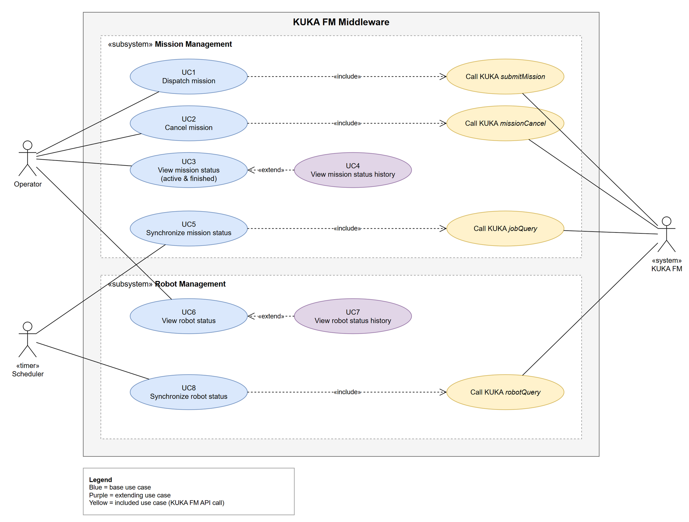

**Actors**
- **Operator** – user of the web UI (no users/roles on middleware side).
- **Scheduler** (timer) – backend background jobs polling KUKA FM.
- **KUKA FM** (external system) – KUKA AMR Fleet Manager at `https://kukafm.its.fei`.

**Subsystems:** Mission Management (UC1–UC5), Robot Management (UC6–UC8).

| ID | Use case | Actor | Goal | Main scenario |
|---|---|---|---|---|
| UC1 | Dispatch mission | Operator | Send a new RACK_MOVE mission to KUKA FM. | Operator fills robot, start node, target node, container code and priority → system validates input → calls KUKA `submitMission` → stores mission (Created) → shows confirmation. *Alt:* KUKA error is shown and logged; mission is not stored. |
| UC2 | Cancel mission | Operator | Stop an active mission. | Operator selects an active mission and confirms → system calls KUKA `missionCancel` (FORCE) → logs and confirms. Final status *Cancelled* is stored by UC5. *Alt:* mission not active → 409. |
| UC3 | View mission status | Operator | See current status of active and finished missions. | Operator opens Missions → system shows missions with current status (filter All / Active / Finished) → list refreshes every 1 s. |
| UC4 | View mission status history (extends UC3) | Operator | See all previous statuses of a mission. | Operator enables *Show history* → system shows previous states with timestamps. |
| UC5 | Synchronize mission status | Scheduler | Keep stored mission statuses up to date. | On interval system loads active missions (10, 20, 25, 28, 50) → calls KUKA `jobQuery` → for changed missions stores previous state in history and updates current state. Final statuses (30, 31, 35, 60) are no longer polled. |
| UC6 | View robot status | Operator | See current state of all robots. | Operator opens Robots → system shows robots with state Available / Busy / Offline, KUKA status, battery, node and mission → list refreshes every 1 s. |
| UC7 | View robot status history (extends UC6) | Operator | See all previous states of a robot. | Operator enables *Show history* → system shows previous states with timestamps. |
| UC8 | Synchronize robot status | Scheduler | Keep stored robot states up to date. | On interval (first on startup) system calls KUKA `robotQuery` → inserts new robots, for changed robots stores previous state in history and updates current state. |

## 4. Procesný diagram / diagram aktivít

Sources: [process-diagrams/](process-diagrams/)

Participants: Web UI (Operator) or Scheduler, Middleware, KUKA FM, Database. View use cases read only from the database; KUKA FM is queried only by the scheduler jobs. Robot sync runs first on startup, then mission sync.

### 4.1 UC1 – Dispatch mission

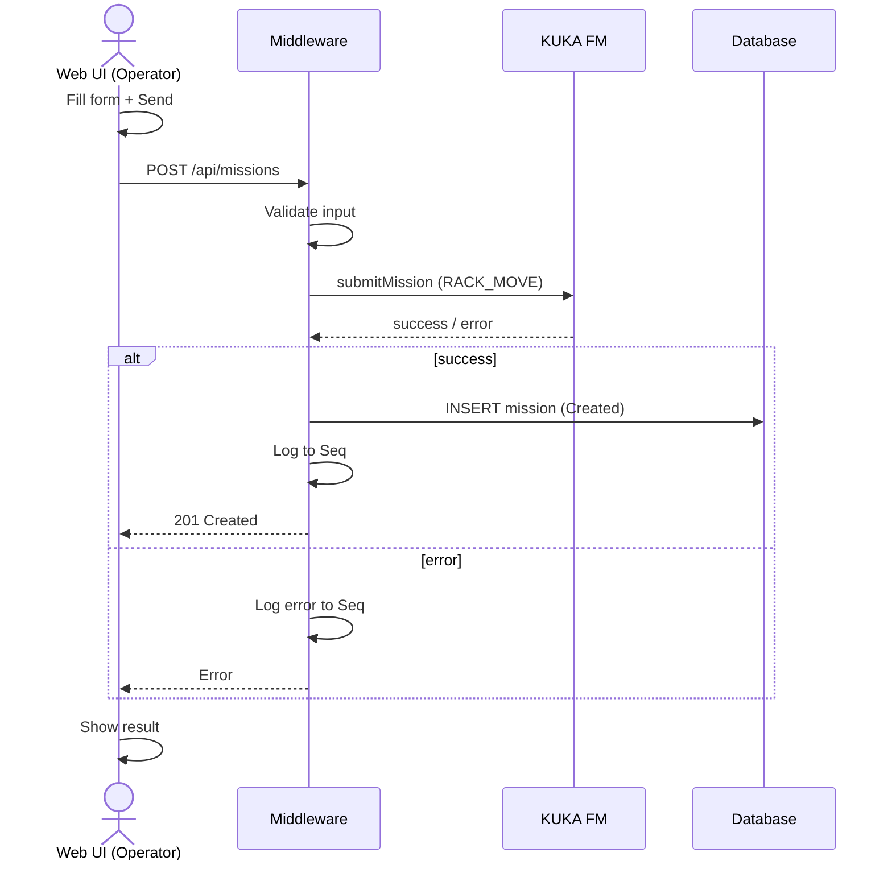

### 4.2 UC2 – Cancel mission

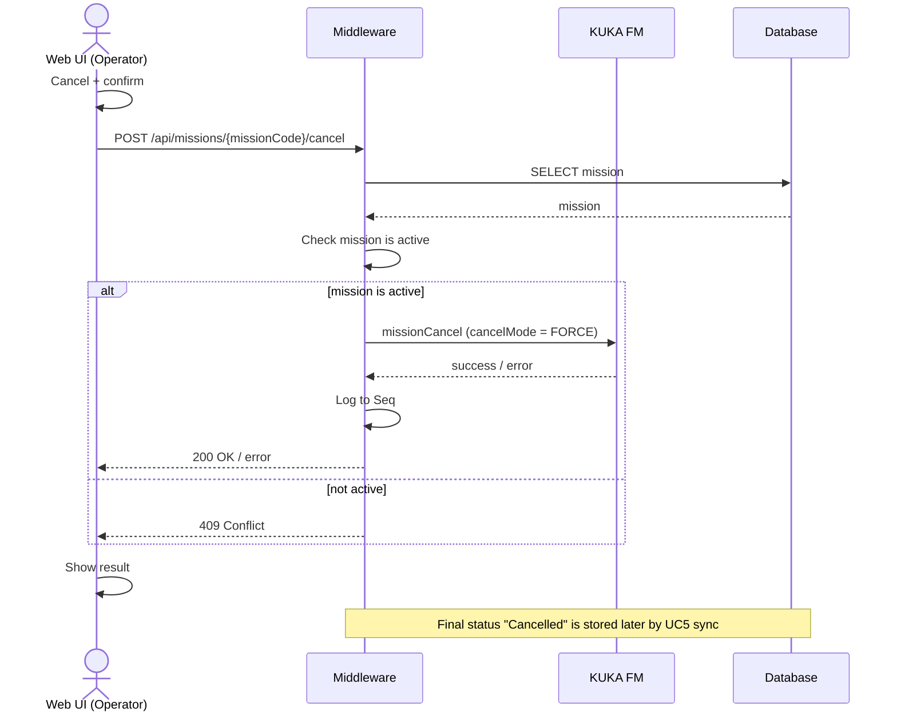

### 4.3 UC3 – View mission status

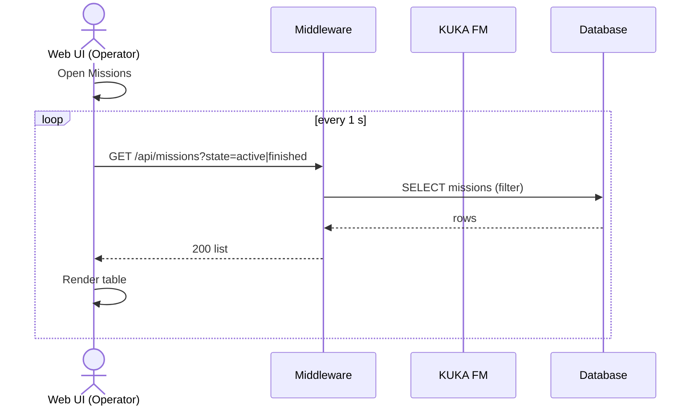

### 4.4 UC4 – View mission status history

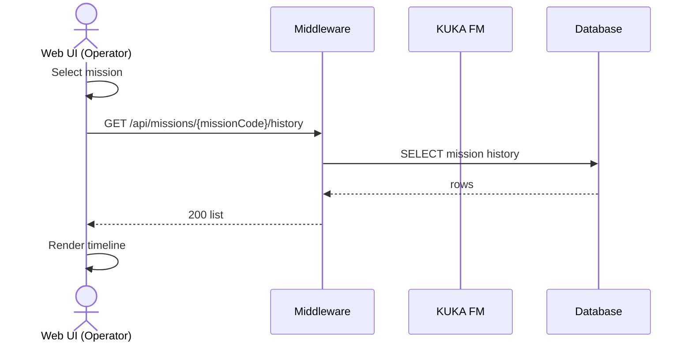

### 4.5 UC5 – Synchronize mission status

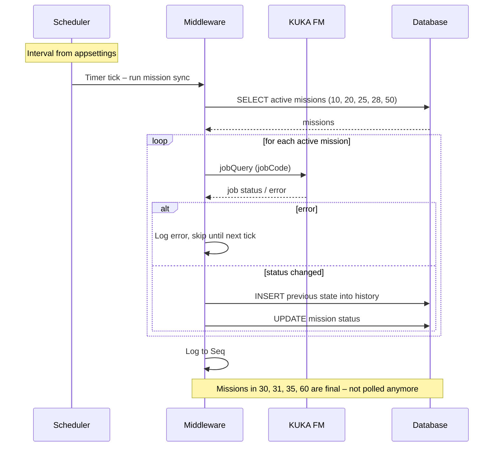

### 4.6 UC6 – View robot status

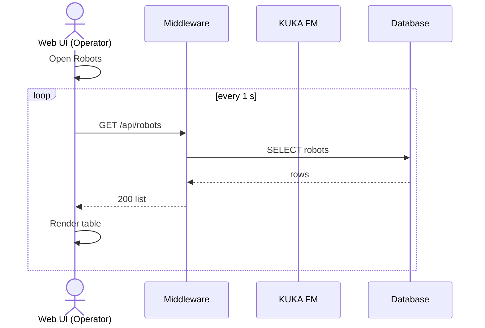

### 4.7 UC7 – View robot status history

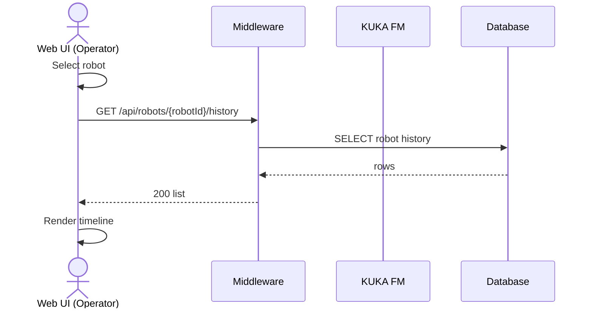

### 4.8 UC8 – Synchronize robot status

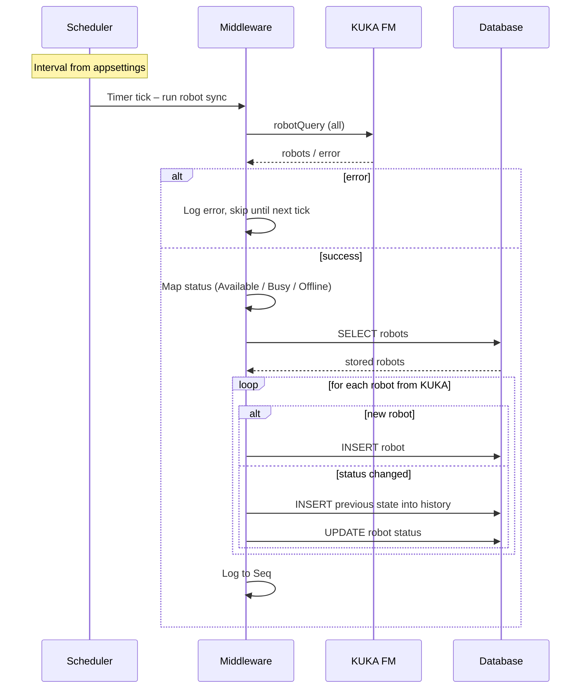

## 5. Dátový model (ERD)

Source: [erd.drawio](erd.drawio)

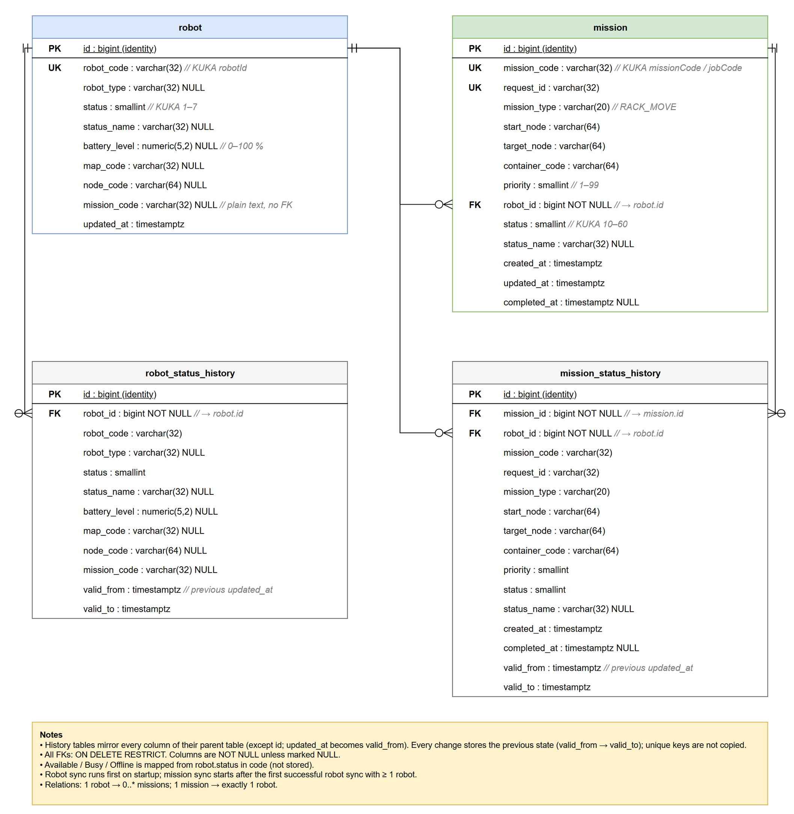

| Entity | Purpose |
|---|---|
| `robot` | Current state of each robot from `robotQuery` (`robot_code` = KUKA `robotId`). |
| `robot_status_history` | Previous states of a robot – mirrors every `robot` column, one row per change (`valid_from` → `valid_to`). |
| `mission` | Missions dispatched by the middleware; current status from `jobQuery`. |
| `mission_status_history` | Previous states of a mission – mirrors every `mission` column, one row per change. |

**Relations:** 1 robot → 0..* missions (each mission has exactly 1 robot, `robot_id` NOT NULL) · 1 robot → 0..* robot history rows · 1 mission → 0..* mission history rows · 1 robot → 0..* mission history rows. All FKs `ON DELETE RESTRICT`.

**Rules:**
- History tables mirror every column of their parent table (except `id`; `updated_at` becomes `valid_from`); unique keys are not copied.
- Every change stores the previous state in the history table.
- Columns are NOT NULL unless marked NULL (nullable: values KUKA may not return, `robot.mission_code`, `mission.completed_at`).
- Available / Busy / Offline is mapped from `robot.status` in code (Idle → Available; Departure, Executing, Charging, Updating → Busy; Offline, Abnormal → Offline).

## 6. Návrh view aplikácie

Source (interactive mockup): [mockups/views-mockup.html](mockups/views-mockup.html)

Both views poll the backend every 1 s (*Auto-refresh*) and can show historical rows (*Show history*).

### 6.1 Missions – list with status and history

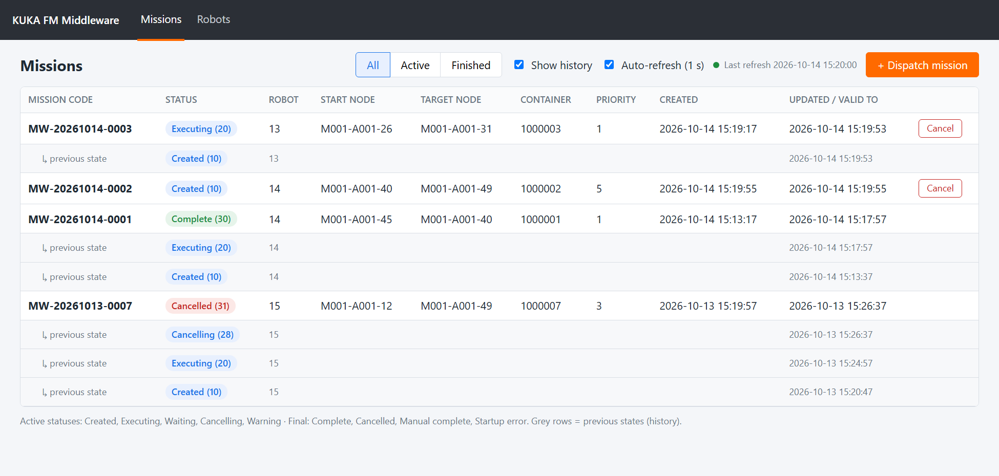

### 6.2 Missions – dispatch new mission

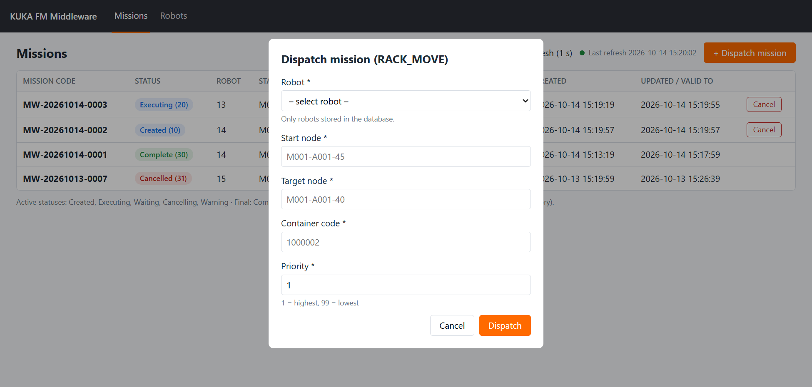

### 6.3 Missions – cancel running mission

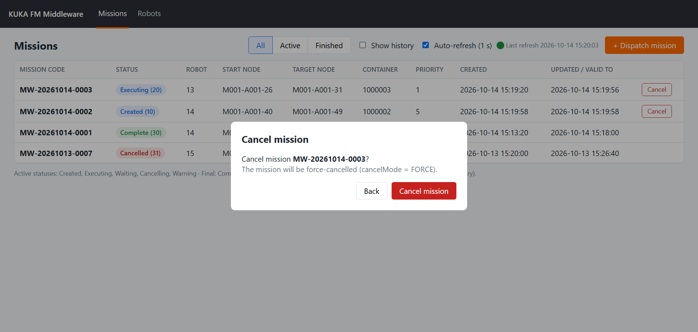

### 6.4 Robots – list with state and history

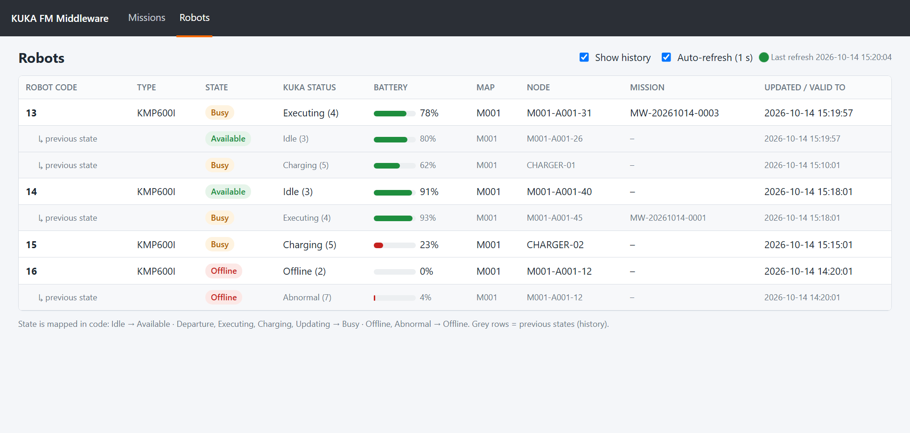

## 7. Technológie

Použité technológie pri vývoji middlewaru, napr.:
  - Backend: ASP.NET Core minimal API (C#), Entity Framework Core.
  - DB: PostgreSQL.
  - Frontend: jednoduchý web (napr. Blazor, React alebo aj čistý HTML/JS — podľa preferencie tímu).
  - Kontajnerizácia: Docker + docker-compose.

## 8. Akceptačné kritériá

- [ ] Je možné zadať novú misiu.
- [ ] Je možné zrušiť prebiehajúcu misiu.
- [ ] Je možné prezretie stavu prebiehajúcich, ktoré sa aktualizujú v reálnom čase, a ukončených misií.
- [ ] Je možné prezretie stavu robotov, ktoré sa aktualizujú v reálnom čase.
- [ ] Prístup ku KUKA FM API volaniu je zabezpečený access tokenom.
- [ ] Všetky operácie vykonané používateľom sú logované.
- [ ] Proces testovania a nasadenia je plne automatizovaným využitím CI/CD pipeline.
- [ ] Finálne riešenie je kompletne zdokumentované vo Wiki.